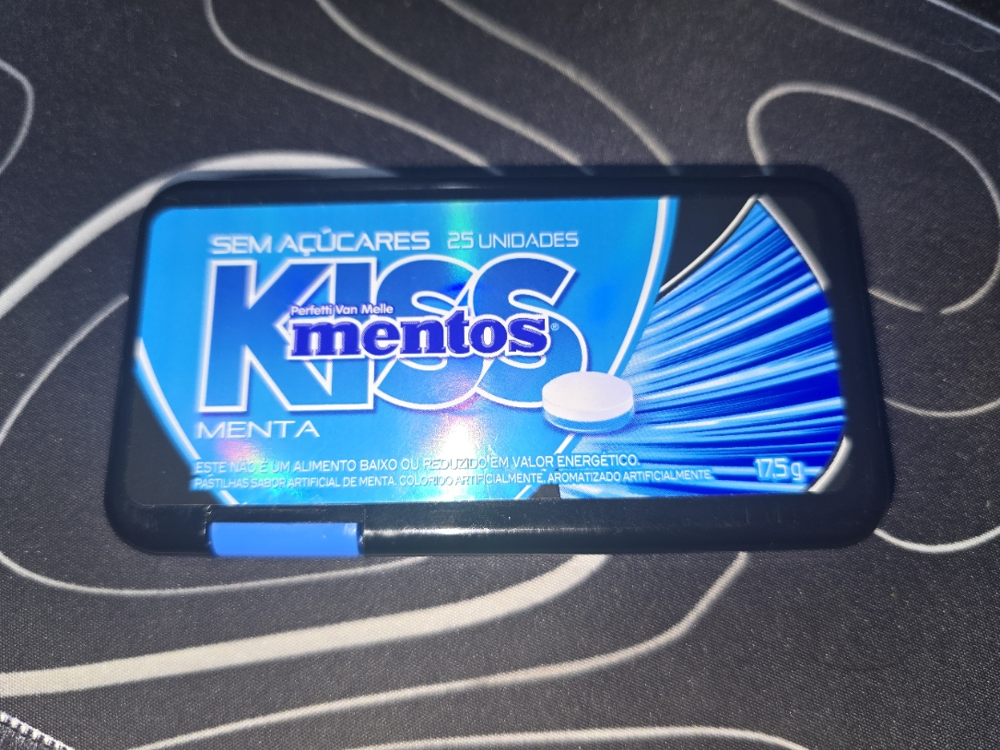
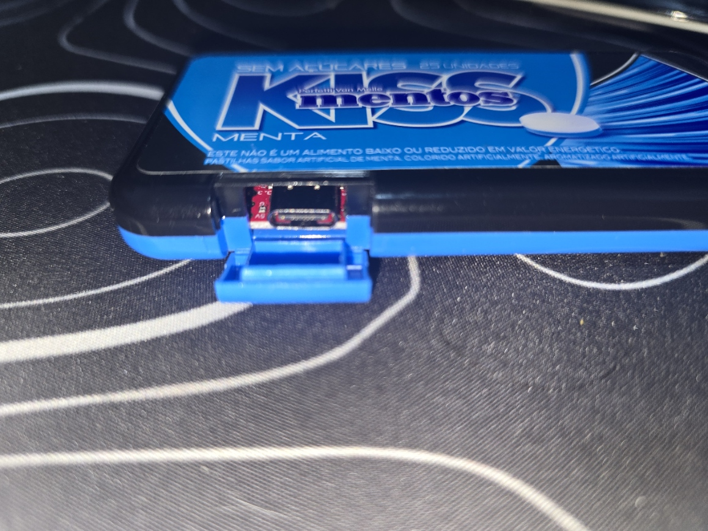
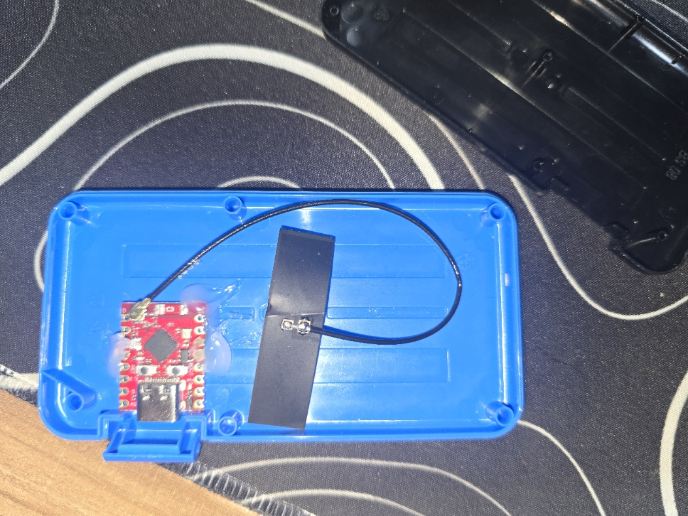

# MentosArmyKnife-C3

Caixa de ferramentas de rede para demonstrações autorizadas, com operações
reais, painel local para projeção e relatórios exportáveis. Alvo:
**ESP32-C3 SuperMini, sem SD**.

## O dispositivo

O hardware: um ESP32-C3 escondido dentro de uma caixa de Mentos — discreto, do
tamanho da palma da mão, alimentado por USB. Três vistas em sequência:

| 1 | 2 | 3 |
|:-:|:-:|:-:|
|  |  |  |

## Ferramentas implementadas

- Recon Wi-Fi: SSID, BSSID, canal, RSSI e autenticação.
- Dashboard para escolher SSID, informar senha e conectar o uplink Wi-Fi.
- Diagnóstico: IP, máscara, gateway, DNS e canal da conexão.
- Recon TCP de um IP na sub-rede conectada: portas 22, 53, 80, 443, 445,
  3389, 8080 e 8443; execução incremental, com botão Parar.
- Consulta de nomes pelo resolvedor DNS do uplink e descoberta mDNS de
  serviços HTTP/HTTPS, IPP, SSH, SMB e estações.
- Monitor passivo de probe requests no canal atual; exportação PCAP em RAM.
- Consultas recebidas pelo DNS do AP e envios do portal de laboratório.
- Relatório JSON baixável no dashboard e enviável ao Discord como anexo.
- Console com navegação lateral por ferramentas, sem cenários ou revelação
  no dashboard; modo de projeção, logs e relatórios em áreas próprias.
- Status de fila, entrega, erros HTTP e descarte de eventos.
- Scanner BLE agregado disponível pela API; detalhamento BLE é trabalho futuro.

Os valores enviados ao portal aparecem em texto claro e entram no relatório.
Use contas de laboratório para demonstrar esse fluxo. A senha do operador,
a senha do uplink e o webhook não são incluídos no relatório.

**Parar preserva resultados.** Limpar resultados é uma ação separada e também
cancela envios pendentes. Desligar perde a RAM; downloads e mensagens já
enviadas permanecem. A fila não é armazenamento durável.

## Preparar e usar

```bash
python3 -m venv .venv
source .venv/bin/activate
pip install platformio
scripts/smoke-test.sh
pio run -e mentos-c3 -t buildfs
# Somente após confirmar chip e porta:
scripts/flash.sh /dev/ttyACM0
python3 scripts/provision-serial.py --port /dev/ttyACM0
```

Conecte-se ao AP `WiFi Visitantes` e abra `http://192.168.4.1/`.
Entre com a senha do operador. Atualizar a página restaura a sessão válida
sem solicitar a senha novamente (validade de 15 minutos; reboot e logout
encerram a sessão). Em **Conexão Wi-Fi**, busque redes, escolha o
SSID e conecte; a configuração fica salva na NVS. O painel mostra o IP quando
conectado. Inicie a verificação TCP de um IP de laboratório ou uma consulta DNS.
Em **Relatórios**, baixe o JSON ou envie ao Discord.

O webhook e a habilitação do Discord continuam provisionados por serial.
Com o feed habilitado, início/fim de TCP e resultados DNS/mDNS aparecem como
mensagens ao vivo. O botão Enviar relatório publica o snapshot completo.
O envio usa HTTPS com validação da cadeia de certificados e requer horário
sincronizado por NTP. Status `queued`/`retrying` não confirma entrega;
`sent` confirma resposta HTTP de sucesso. Código -2 indica relógio pendente;
-1 indica falha de transporte/TLS. Não há bypass de certificado.

## PCAP / tshark

O C3 não executa tshark. O buffer PCAP foi adaptado do USBArmyKnife e guarda
**apenas probe requests observados**, sem FCS/radiotap, até 8 KB; registros
limitados a 512 bytes. A contagem de descartes consta no relatório JSON.
Baixe o PCAP e analise no computador, por exemplo:

```bash
tshark -r mentos-probes.pcap -Y 'wlan.fc.type_subtype == 4'
```

Os tempos são relativos ao boot, não horários de calendário. O dispositivo
não fornece captura completa da LAN, descriptografia HTTPS/WPA ou histórico
comprovado de conexões dos aparelhos. `no_connection` em TCP não distingue
porta fechada, filtragem e timeout. Porta aberta não comprova vulnerabilidade.

## Limites e validação

- O AP e o uplink compartilham rádio/canal; a troca de rede pode interromper
  brevemente o acesso ao dashboard. Não há bridge/NAT implementado.
- A varredura Wi-Fi é síncrona; DNS e POST HTTPS também podem atrasar o painel.
- Suporte inicial a rede aberta ou PSK; não há configuração 802.1X Enterprise.
- A exportação Discord aceita um relatório pendente de até 24 KB. Eventos usam
  fila separada de dez entradas, com contagem de descarte e tentativas espaçadas.
- Firmware compilado não significa validado em placa: testar rádio, DHCP,
  PCAP, TLS/NTP, entrega Discord e STOP no hardware antes de apresentar.

## Origem e documentação

Importação seletiva do [USBArmyKnife](https://github.com/i-am-shodan/USBArmyKnife),
com licença e proveniência em [third_party/USBArmyKnife](third_party/USBArmyKnife/UPSTREAM.md).
Não é um port integral; USB HID/MSC/NCM não está disponível no USB nativo do C3.
Veja [direção do produto](docs/toolbox-direction.md) e
[matriz de demonstrações](docs/network-tools.md). O plano original e o roteiro
antigo são históricos e não definem os novos requisitos de exportação.

Licença MIT: [LICENSE](LICENSE); os trechos importados preservam a licença upstream.

### Portal de simulação (0.2.2)

O portal `/portal` apresenta uma tarja vermelha permanente e os botões **Simular
Google** e **Simular Apple**. As contas mostradas são exemplos fixos no domínio
`example.invalid`; não há campos para digitar credenciais nem autenticação real.
Ao confirmar, o dispositivo registra apenas um evento de simulação, encaminhado
à fila do Discord quando a integração está habilitada. Registro local não é
confirmação de entrega ao Discord: confira uplink e status no dashboard.

O endpoint `/portal/submit` aceita exclusivamente `provider=google` ou
`provider=apple`, sem parâmetros adicionais. Funciona em PORTAL_READY e
DEMO_RUNNING; STOP bloqueia novos registros. Essa interface substitui o antigo
formulário de usuário/senha; descrições antigas de captura não se aplicam ao
portal atual. Dados previamente armazenados em RAM só são removidos por limpeza
ou reinicialização.
